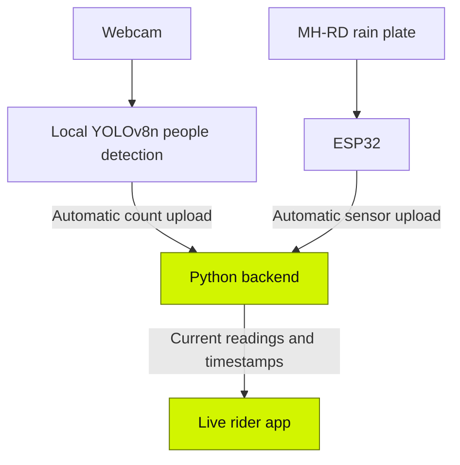
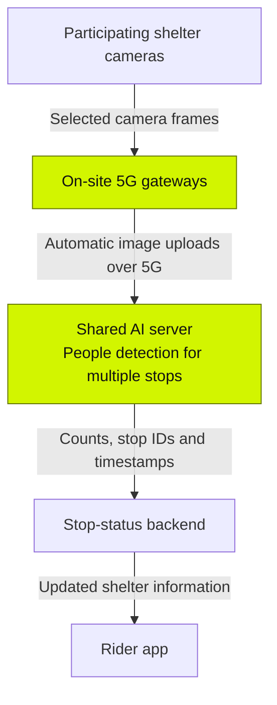

<div align="center">

# 🌧️ TeduhLink

## 🛵 Find Shelter. Check the Crowding. Choose Your Stop.

### 🌐 *Connected shelter information for Cyberjaya riders*

**Cyberjaya 5G Future Talent Innovation Challenge 2026**  
*5G Connected & Safe Last-Mile Mobility*


[](https://d1msums.github.io/teduhlink/)
[](https://github.com/d1msums/teduhlink)

[Overview](#project-overview) · [Local context](#inspiration-and-local-context) · [How it works](#how-it-works) · [Run locally](#run-the-working-prototype) 

</div>

<a name="project-overview"></a>

## 🌧️ Project overview

When rain interrupts a delivery, riders need somewhere suitable to stop. TeduhLink helps them browse proposed shelter locations and compare estimated crowding before choosing a stop.

Our controlled indoor prototype combines an ESP32 rain-contact sensor, automatic people detection and a live app. A separate public interactive demo explains the rider experience using simulated readings and illustrative distances.

**[Open the public interactive demo](https://d1msums.github.io/teduhlink/)**

The demo uses real Cyberjaya place names to explain proposed locations. It does not show sensors installed at those premises or imply permission or partnership.

<a name="inspiration-and-local-context"></a>

## 📍 Inspiration and local context

TeduhLink is inspired by the existing TEDUH rider shelter initiative. [Media Selangor’s September 2025 report](https://mediaselangor.com/en/2025/09/320927) identifies a planned MPSepang TEDUH hub off Jalan Teknokrat 6 in Cyberjaya. This gives the proposal a concrete local infrastructure context; it does not establish the facility’s current operating status.

[Rider accounts published in September 2026](https://mediaselangor.com/en/2026/09/393885) describe unpredictable weather and seeking cover at available places. Those interviews concern riders around Petaling Jaya and the Klang Valley, and are not a Cyberjaya survey conducted by our team.

[Malaysian occupational safety research](https://doi.org/10.5772/intechopen.110783) also identifies exposure to heavy rain and thunderstorms among delivery riders’ hazards. Our proposal addresses shelter information within that wider problem. We have not measured crash reduction, rider adoption or time savings.

## 📱 What riders can see

- Listed shelter options and proposed locations.
- **No people detected**, **Some people detected**, or **Busy** for a monitored image region.
- A rain-sensor water-contact indication with its observation age.
- Independent unavailable states when a camera or sensor stops updating.
- An illustrative comparison of distance and crowding in the public journey.

The demo uses **three people or more as Busy**. This is a demonstration threshold, not a verified shelter capacity. People counts do not measure free seats, motorcycle bays or permission to stop. Riders remain responsible for choosing a suitable place and should stop safely before using the phone.

<a name="how-it-works"></a>

## ⚙️ How it works

### 🛠️ Working indoor prototype



The camera model counts visible people whose detection centres fall inside a selected area. Recent observations stabilise the estimate. Uploads and app updates happen automatically, without manual count entry or approval.

The rain plate detects water contacting its surface. Outdoors, this can indicate rain at the sensor, but splashes and residual moisture can also affect it. It does not predict rain, measure road grip or establish rainfall intensity.

Each stream has its own freshness state. In the current prototype, readings expire after ten seconds. A missing camera reading is displayed as unavailable, rather than zero people.

### 📡 Proposed deployment over 5G



The shared server would run people detection for participating locations, reducing the need for an AI computer at each stop. Existing CCTV could be used only with owner approval and a suitable view, stream format and network connection.

The intended 5G workload is repeated camera-image uploads across distributed sites, particularly where fixed broadband is impractical. Small rain-sensor messages alone do not require 5G. Suitable 4G or fixed broadband may also support the service. A field comparison must establish whether 5G improves count freshness, delivery success or deployment practicality for the selected workload.

**The current prototype uses local processing. Multi-site 5G image delivery and its performance benefits remain proposed.** 

## ✅ Prototype status

- ESP32 sensor-to-backend updates: tested by the team.
- Camera counting-to-app integration: passed, as reported by the team.
- Public interactive journey: simulated experience for reviewers.
- Multi-site shared AI over 5G: proposed architecture.

<a name="run-the-working-prototype"></a>

## 🚀 Run the working prototype

The portable setup requires Windows, Python 3.11 with the Python launcher, a webcam and internet for initial downloads. Keep `ml`, `backend` and `frontend` together.

```powershell
git clone https://github.com/d1msums/teduhlink.git
cd teduhlink
.\ml\1_SETUP.cmd
.\ml\START_LOCAL_APP.cmd
```

Keep the backend terminal open. In a second terminal at the repository root:

```powershell
.\ml\3_START_CONNECTED_CAMERA.cmd
```

Open the live app at:

**http://127.0.0.1:8000/stop_a_details_teduhlink/code.html**

Select the camera counting area and press Enter. Test an empty area, one person, three people and people leaving. The rain reading can be unavailable when no ESP32 is connected to this PC.

See [the full ML setup and recording guide](ml/README.md) for instructions and troubleshooting. These launcher commands require the updated ML handoff files to be committed to this repository.

The GitHub Pages demo is a separate simulated experience and does not receive these local webcam uploads.

## 📂 Repository structure

```text
teduhlink/
├── backend/    Python API, local launcher and private runtime data
├── ml/         People detection, setup scripts and teammate guide
├── frontend/   Live app interface and data integration
└── docs/       Public demo files when Pages uses the /docs source
```

GitHub Pages can also publish from the repository root, depending on the configured publishing source. Keep its HTML and required assets together.

## 🔧 Implementation considerations

A field deployment needs site-owner permission, verified stop access, power, weather protection, suitable camera coverage, connectivity and maintenance. Proposed stakeholders include MPSepang, participating private facility owners, Cyberview and connectivity providers. No partnership is confirmed.

The system does not identify faces. A deployed service should minimise camera coverage, restrict access to imagery and discard frames after processing unless a separately approved retention purpose exists. The rider app should receive status information rather than public camera feeds.

Do not commit private tokens, `.env` files, databases, `.venv`, model weights or participant recordings. Review the model’s licence before any deployment beyond the student prototype.

<a name="team"></a>

## 📚 References

- [Media Selangor: Selangor councils get RM30,000 each to build delivery rider rest stops](https://mediaselangor.com/en/2025/09/320927), 16 September 2025.
- [Media Selangor: TEDUH gives Selangor riders respite from sun, rain and the road](https://mediaselangor.com/en/2026/09/393885), 4 September 2026.
- [Zulkifly: Work-Related Safety and Health Issues among Food and Parcel Delivery Riders](https://doi.org/10.5772/intechopen.110783), 2023.
- [Ultralytics YOLOv8 documentation](https://docs.ultralytics.com/models/yolov8/).
- [Cyberjaya 5G Future Talent Innovation Challenge](https://cyberjaya5g.kolaxus.net/).

Independent student prototype inspired by TEDUH. No council endorsement, approved outdoor installation or verified facility partnership is implied.
